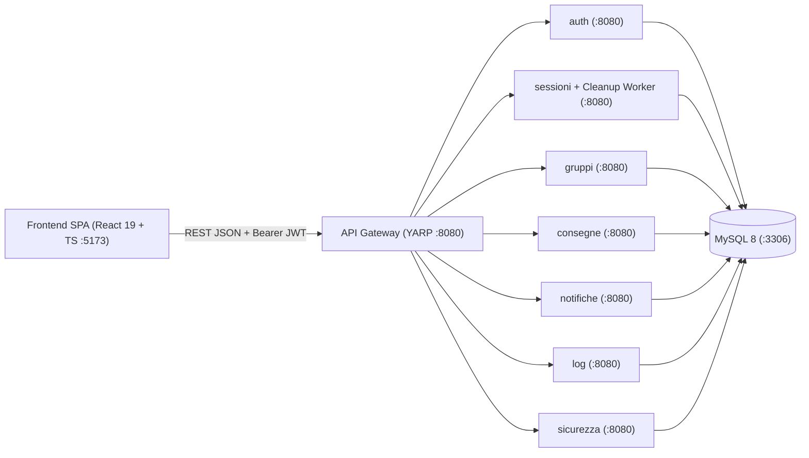

# UniProject-Hub


**UniProject-Hub** è una piattaforma web full-stack basata su **architettura a microservizi** progettata per digitalizzare e governare l'intero ciclo di vita dei progetti didattici universitari: dalla creazione delle sessioni d'esame e formazione dei team di studenti, fino alla revisione degli abstract, consegna degli elaborati con timestamp immutabile, valutazione e audit di sicurezza.

---

## Indice

- [Architettura del Sistema](#architettura-del-sistema)
- [Stack Tecnologico](#stack-tecnologico)
- [Funzionalità Principali](#funzionalità-principali)
- [Avvio Rapido con Docker](#avvio-rapido-con-docker)
- [Credenziali Demo](#credenziali-demo)
- [Sviluppo Locale e Testing](#sviluppo-locale-e-testing)
- [Struttura del Progetto](#struttura-del-progetto)
- [Documentazione](#documentazione)
- [Note di Progetto e Sviluppi Futuri](#note-di-progetto-e-sviluppi-futuri)

---

## Architettura del Sistema

Il backend adotta un'architettura a **7 microservizi ASP.NET Core** disaccoppiati per dominio applicativo ed esposti tramite un **API Gateway basato su YARP (Yet Another Reverse Proxy)**. La persistenza è affidata a **MySQL 8** con modellazione relazionale a gerarchie disgiunte e integrità referenziale ACID.



| Componente | Responsabilità |
|---|---|
| `gateway` | Reverse proxy YARP (`/api/{servizio}/*`), punto d'ingresso unico e gestione CORS per la SPA |
| `auth` | Registrazione con validazione dominio istituzionale, hashing **BCrypt**, emissione **JWT** e blocco automatico anti-brute-force |
| `sessioni` | Gestione sessioni didattiche, generazione codici univoci a 8 caratteri, appelli e `BackgroundService` per la pulizia automatica delle sessioni inattive da oltre 6 mesi |
| `gruppi` | Ciclo di vita della composizione dei team di progetto, inviti diretti, richieste di accesso e passaggio automatico di leadership in caso di abbandono |
| `consegne` | Invio e revisione degli abstract, caricamento elaborati con **timestamp immutabile**, assegnazione e accettazione/rifiuto della valutazione |
| `notifiche` | Sistema asincrono di notifiche utente interrogato tramite HTTP polling periodico |
| `log` | Raccolta e consultazione centralizzata degli eventi di audit e sicurezza |
| `sicurezza` | Monitoraggio tentativi falliti e blocco/sblocco manuale degli account |

---

## Stack Tecnologico

- **Frontend**: React 19, TypeScript, Vite, React Router v7, Nginx (container produzione)
- **API Gateway**: ASP.NET Core + YARP (`Yarp.ReverseProxy`)
- **Backend Microservices**: C#, ASP.NET Core Web API, Entity Framework Core (Pomelo MySQL Provider)
- **Sicurezza**: Autenticazione stateless JWT (HMAC-SHA256), RBAC basato su claim di ruolo, `BCrypt.Net-Next`, lockout temporaneo dopo 3 tentativi errati
- **Database**: MySQL 8.0 (`utf8mb4`)
- **Testing**: xUnit, `Microsoft.AspNetCore.Mvc.Testing` (`WebApplicationFactory`), `Testcontainers.MySql` per integration test end-to-end su istanze MySQL reali
- **DevOps**: Docker multi-stage build, Docker Compose, GitHub Actions CI

---

## Funzionalità Principali

### Autenticazione e Sicurezza (`Gestore Sicurezza`)
- Assegnazione automatica e vincolante del ruolo in base al dominio istituzionale (`@studio.unibo.it` → `STUDENTE`, `@unibo.it` → `DOCENTE`).
- Validazione policy di complessità password e hashing con salt tramite **BCrypt**.
- Protezione brute-force: blocco automatico dell'account per 15 minuti al terzo tentativo fallito consecutivo e tracciamento su `log_eventi`.
- Dashboard dedicata per il **Gestore della Sicurezza** per ispezionare l'audit log e bloccare/sbloccare manualmente le utenze.

### Area Docente (`DOCENTE`)
- Creazione di sessioni progettuali con generazione automatica del codice di accesso univoco.
- Configurazione della data di apertura per l'invio degli abstract e pianificazione degli appelli con relative scadenze.
- Revisione degli abstract inviati (approvazione o richiesta di modifiche con feedback motivato).
- Valutazione degli elaborati consegnati (fino a 30 e lode) e monitoraggio dello stato di accettazione del voto.

### Area Studente (`STUDENTE`)
- Accesso alla sessione tramite codice fornito dal docente, ricerca e filtro dei team aperti.
- Gestione inviti, richieste di partecipazione e timeline visuale dello stato di avanzamento (`NUOVO` → `ABSTRACT_CONSEGNATO` → `ABSTRACT_VALUTATO` → `PROGETTO_CONSEGNATO` → `PROGETTO_VALUTATO`).
- Invio/riconsegna dell'abstract, consegna unica dell'elaborato con registrazione immutabile della data/ora UTC e accettazione o rifiuto del voto assegnato.
- Centro notifiche integrato con badge di lettura in tempo reale (HTTP polling).

---

## Avvio Rapido con Docker

### Prerequisiti
- [Docker Desktop](https://www.docker.com/products/docker-desktop/) (con Docker Compose v2)

### Esecuzione

1. *(Opzionale)* Crea il file `.env` a partire dal template per personalizzare password del database e chiave JWT:
   ```bash
   cp .env.example .env
   ```

2. Costruisci e avvia l'intero stack (MySQL + 7 microservizi + API Gateway + Frontend SPA):
   ```bash
   docker compose up --build
   ```

3. Accedi all'applicazione:
   - **Web App (Frontend)**: http://localhost:5173
   - **API Gateway**: http://localhost:8080/health

Per arrestare i container e rimuovere i volumi temporanei:
```bash
docker compose down -v
```

---

## Credenziali Demo

All'avvio del container MySQL, lo script [`db/init.sql`](./db/init.sql) popola automaticamente il database con utenze dimostrative pronte all'uso:

| Ruolo | Email | Password | Codice Sessione |
|---|---|---|---|
| **Docente** | `mario.rossi@unibo.it` | `DemoPass1!` | *(non richiesto)* |
| **Studente** | `marco.verdi@studio.unibo.it` | `DemoPass1!` | `AB3XK9MQ` |
| **Studente** | `giulia.neri@studio.unibo.it` | `DemoPass1!` | `AB3XK9MQ` |
| **Studente** | `alessio.blu@studio.unibo.it` | `DemoPass1!` | `AB3XK9MQ` |
| **Gestore Sicurezza** | `anna.bianchi@unibo.it` | `DemoPass1!` | *(non richiesto)* |

---

## Sviluppo Locale e Testing

### Eseguire la suite di test (.NET + Testcontainers)
La soluzione include **8 progetti di test** in [`tests/`](./tests) che combinano **Unit Test** (isolati tramite repository fake in-memory) e **Integration Test** sugli endpoint HTTP reali (con `WebApplicationFactory` e container MySQL effimeri gestiti da `Testcontainers`).

Assicurati che Docker sia attivo ed esegui:
```bash
dotnet test UniProjectHub.sln
```

### Avviare il Frontend in modalità sviluppo (HMR)
```bash
cd frontend
npm install
npm run dev
```

---

## Struttura del Progetto

```text
UniProject-Hub/
├── .github/workflows/ci.yml   # Pipeline CI (build & test .NET + lint & build React)
├── db/
│   └── init.sql               # Schema relazionale MySQL 8 e seed dati demo
├── docs/                      # Documentazione progettuale in formato PDF
├── frontend/                  # Single Page Application (React 19 + TypeScript + Vite)
├── gateway/                   # API Gateway reverse proxy (YARP)
├── services/                  # Microservizi ASP.NET Core
│   ├── auth/                  # Autenticazione, registrazione, JWT e password policy
│   ├── sessioni/              # Sessioni, appelli e job schedulato di cleanup
│   ├── gruppi/                # Formazione team, inviti e richieste di accesso
│   ├── consegne/              # Abstract, elaborati e valutazioni
│   ├── notifiche/             # Endpoint notifiche utente
│   ├── log/                   # Consultazione audit log
│   └── sicurezza/             # Gestione blocchi/sblocchi utenze
├── shared/                    # Libreria contratti comuni (healthcheck, logger, publisher)
├── tests/                     # 8 suite di Unit e Integration Test (xUnit + Testcontainers)
├── .env.example               # Template configurazione variabili d'ambiente
├── docker-compose.yml         # Orchestrazione completa dei container
└── UniProjectHub.sln          # Solution file .NET
```

---

## Documentazione

Nella cartella [`docs/`](./docs) è disponibile la documentazione tecnica e architetturale conclusiva del progetto.

---

## Note di Progetto e Sviluppi Futuri

Alcuni aspetti periferici sono stati intenzionalmente semplificati a fini dimostrativi, predisponendo l'architettura per estensioni future:
- **Object Storage per gli elaborati**: la consegna registra in modo immutabile metadati e riferimento al pacchetto `.zip`; l'integrazione di uno storage binario dedicato (es. MinIO / Amazon S3 via `multipart/form-data`) costituisce il naturale passo successivo.
- **Servizio SMTP per recupero credenziali**: l'endpoint `POST /api/auth/recupero-password` restituisce una risposta neutra anti-user-enumeration ed è predisposto per l'aggancio a un provider email transazionale.
- **Database-per-Service & Event Bus**: i microservizi operano su tabelle logicamente separate all'interno di un'istanza MySQL condivisa per privilegiare consistenza transazionale e semplicità di deploy; la separazione già netta dei `DbContext` consente una futura migrazione verso database dedicati sincronizzati tramite message broker (es. RabbitMQ).
